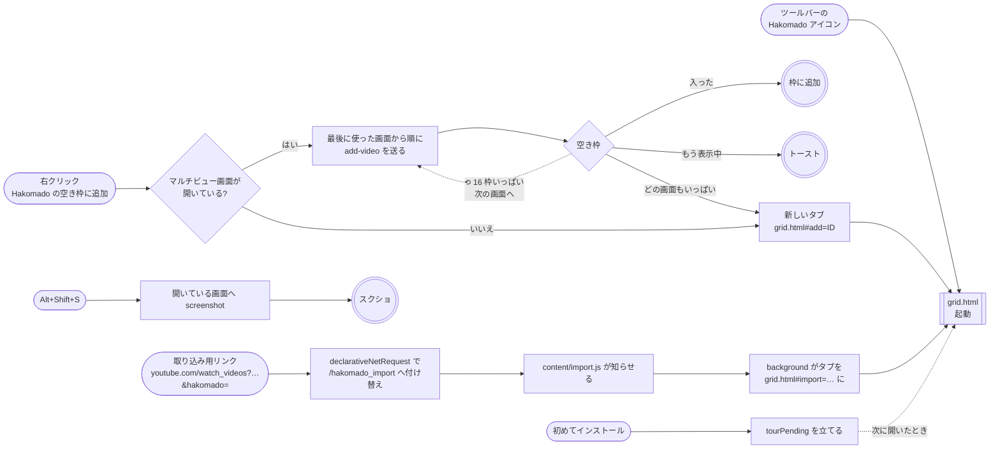
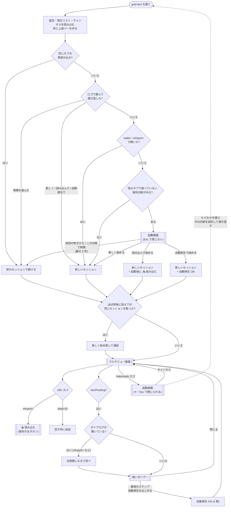
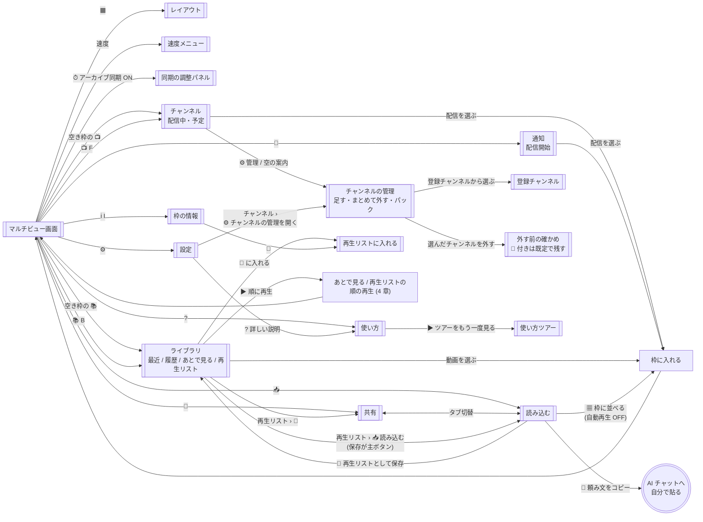
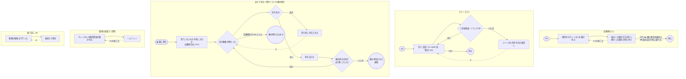
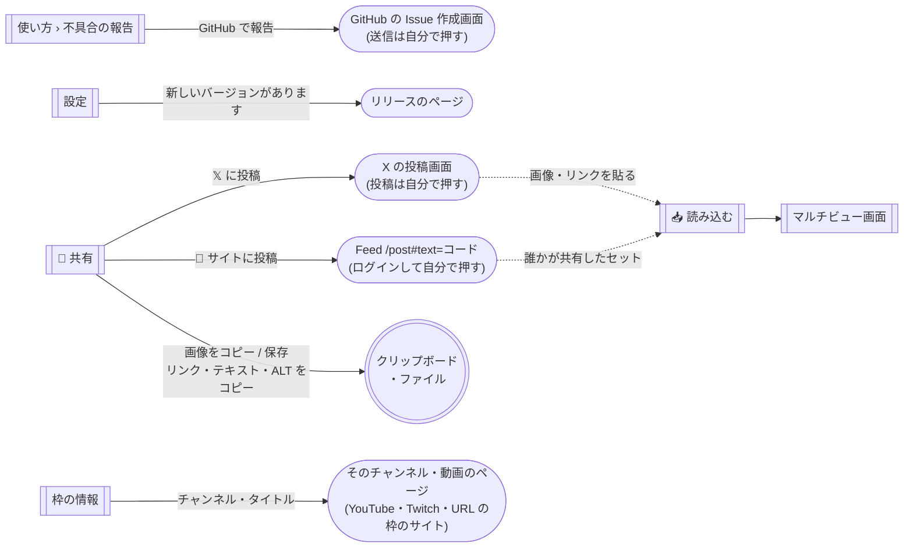

# Hakomado 画面遷移図

拡張機能 (`extension/`) の入口から、マルチビュー画面・各ダイアログ・自動で回る処理・外へ出る操作までを、`background.js`・`grid.js`・`grid.html` から起こした図。画面や流れを変えたらこの図も直す。

## 凡例

| 記号 | 意味 |
| --- | --- |
| `([ 開始 ])` 角丸 | 操作のきっかけ・入口 |
| `[[ 画面 ]]` 二重線 | 画面・ダイアログ |
| `{ 分岐 }` ひし形 | 条件で行き先が変わる |
| `[ 処理 ]` 四角 | 裏で行う処理 |
| 点線の矢印 `⟲` | ループ (繰り返し・戻り) |
| `((( 終端 )))` 二重丸 | 流れの終わり |

## 1. 入口 — どこからマルチビュー画面に来るか

入口は 4 つ。どれも最後は `grid.html` (マルチビュー画面) の起動に合流する。右クリックの追加だけは、画面がもう開いていればそこに入れて終わる (16 枠が埋まっている画面は飛ばして次の画面へ、どこにも入らなければ新しいタブ)。

## 2. 起動と起動画面 — ロゴで戻れるループ

起動時に「視聴セッション」を決める (`chooseSession`)。同じタブの再読み込みなら確認なし。上部バーの **Hakomado ロゴ** (`backToStart`) は同じ起動画面をもう一度出し、選ぶと今の内容を保存して画面を開き直すので、起動の流れへ戻るループになる。

- 起動画面の候補は「他のタブで使っていない・枠に何か入っている」保存内容から最大 3 件。起動時は 1 つ目が「▶ 前回の続きから」、2 つ目からが「▶ この内容で再開」。ロゴから開いたときは全部「この内容で再開」で、今のセッション自身は候補に出ない
- 使い方ツアーは、使い方の「▶ 使い方ツアーをもう一度見る」からも始まる (3 章)
- `#import=` で開いたときは、起動画面で「読み込んで始める」を選んでも、リンクの中身を入れた 📥 読み込む (保存が主ボタン) のまま
- 「新しく始める」でも、標準 / ストレッチの表示方法は直近のものを引き継ぐ

## 3. 上部バーからの画面 — マルチビュー画面を中心に行き来する

ほとんどのダイアログは閉じればマルチビュー画面に戻る (図では戻りの線を省き、別の画面に移るものだけ描く)。空き枠の「📺 チャンネルから選ぶ」「📚 ライブラリから選ぶ」から開いたときは、選んだものがその枠に入る。

## 4. 自動で回る処理 — ループと終端

トグルを ON にしている間、タイマーで回り続ける。順の再生だけは、入れるものが無くなると自分で終わる。

- 自動再生と順の再生は同じ枠を取り合うので、同時には動かない。片方を始めると、もう片方は止まる
- 繰り返しは、ライブ配信と、自動再生・順の再生で次を入れる枠には効かない
- アーカイブ同期 (⏱) は ON の間、同期の調整パネル (☰) と時刻のつまみが上部バーに出る

## 5. 外への出口 — 拡張機能から先は人が操作する

拡張機能は Feed や X、GitHub に自分では送らない。新しいタブを開くか、コピー・保存までで止まる。

- 共有 → 相手の 📥 読み込む → 枠に並べる、で 1 周するループになる
